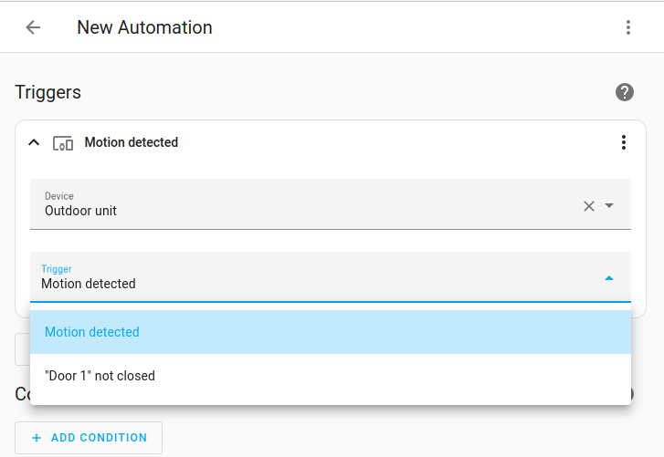

# Home Assistant App: Hikvision Doorbell

## Configuration
**Note**: _Remember to restart the App when the configuration is changed._

**Note**: _When the App connects to a doorbell for the first time, it might happen that your door station gets stuck, because it is downloading the complete backlog of events. You will also see a lot of false events just give it a while, it can sometimes takes a few hours... A reboot might be required._

The following configuration options are available to be setup using the **Configuration** tab of this App in the Home Assistant interface:

### Doorbells
Configure the connection to the doorbells. If a value is not defined, the default setting is used.

For each of your doorbells, repeat the following configuration:

| Option          | Default       | Description                           |
| --------        | ----          | ----                                  |
| name            |               | Custom name for this doorbell (visibile in the HA UI and the sensors names)
| ip              |               | IP address of the doorbell
| port            | 8000          | (Optional) Port of the doorbell
| username        | admin         | Username to access the doorbell
| password        |               | Password to access the doorbell
| output_relays   | 2             | (optional) Set this option if you don't see the correct number of door switches or if you have attached an secure door control module on your indoor
| scenes          | false         | (optional) Extra Scene buttons for indoor panels
| call_state_poll | 5             | (optional) Make the call state poll every 5 sec, for devices that dont support the ringing event, devices for example running 3.7.x or newer... 
| scene_state_poll | 15           | (optional) Make the scene state poll every 15 sec if scenes are enabled
| alarm_state_poll | 15           | (optional) Make the alarm state poll every 15 sec if scenes are enabled


#### Example config
The following configuration setups two doorbells, named `Front door` and `Rear door` and an `Indoor` panel
```yaml
- name: "Front door"
  ip: 192.168.0.1
  username: admin
  password: password
  output_relays: 2

- name: "Indoor"
  ip: 192.168.0.3
  username: admin
  password: password
  scenes: true
  call_state_poll: 5

```

### System
The following system settings are available:

| Name              | Default               | Description                           |
| --------          | ----                  | ----                                  |
| log_level         | WARNING               | The verbosity of the App logs. Available options: _ERROR_ _WARNING_ _INFO_ _DEBUG_
| sdk_log_level     | NONE               | The verbosity of the Hikvision SDK logs. Available options: _NONE_ _ERROR_ _INFO_ _DEBUG_

#### Example config
```yaml
log_level: WARNING
sdk_log_level: NONE
```

## Setup

### Requirements

A running MQTT broker.

You can use the officially supported __Mosquitto broker__, available in the official apps section of your Home Assistant instance. 
You can quickly set it up by clicking the following button:
[](https://my.home-assistant.io/redirect/supervisor_addon/?addon=core_mosquitto), or by manually finding it inside your `App store`.

After you have started the __Mosquitto broker__ App, you should be able to automatically connect Home Assistant to the broker by going to `Settings` -> `Devices & Services` -> `MQTT`, and clicking `Configure`.

(Optional) If you have an external MQTT broker, you can define it the App config too:

#### Example config
```yaml
host: 192.168.0.17
port: 1883
ssl: false
username: user
password: pass
```

### Getting started

After you have setup an MQTT broker, you can start __Hikvision Doorbell__. 
Each of you defined doorbell should be visible as a device under `Settings` -> `Devices & Services` -> `Devices`.

### Sensors, switches, input text and buttons
For each of your doorbells, the following entities are available:

- Sensors
  - `Call state` (_idle_, _ringing_, _dismissed_,)
  - `Scene sensor` (Alarm/Scene events (Indoor Station Only))
  - `Latest snapshot` (On incoming ring event, it will take a snapshot)
- Switches
  - `Door relays` (one for each available relay, open the door connected to the output relay of the device)
- Input Select
  - `Backlight` (Turn the backlight of the outdoor station to on/off/auto)
- Input Text
  - `ISAPI Request` (Custom ISAPI control, see more info below!)
- Buttons
  - `Answer call` (The device needs to be connected to Hikconnect in to make "answer" work, if its not possible, you can use "reject" instead)
  - `Hangup call` (The device needs to be connected to Hikconnect in to make "hangup" work, if its not possible, you can use "reject" instead)
  - `Reject call`
  - `Reboot`
  - `Take Snapshot` (Grabs a snapshot from the outdoor station and updates the image entity)
  - `Broadcast` (Plays a custom audio file on an indoor panel)
  - `Call` (Start a call on an indoor panel and you can also speak (not working with HA Addon, audio card is needed))
  - ...
- Device triggers (depending on device model)
  - `Motion detected`
  - `Tamper alarm`
  - `Door not closed`
  - ...

  The _device triggers_ are used to signal alarms and events generated by the doorbells (the type of events generated depends on the specific model).
  These are special entities that do not have a state associated to them (therefore are not visible in the list of HA entities, but under each `Device info` page). 
  
  **NOTE**: The device triggers are discovered *once the associated event is triggered on the device at least once.*

   **NOTE**: Devices that run newer firmare like 3.7.x dont support the ring event anymore, you need to manually poll it now using the call_state_poll in the config.*
  
  **NOTE**: For some reason there is no "door not closed" device trigger, here is a workaround:

  https://community.home-assistant.io/t/hikvision-doorbell-videointercom-integration/532796/537

  https://community.home-assistant.io/t/hikvision-doorbell-videointercom-integration/532796/2297?
  
  
  You can use a [device trigger](https://www.home-assistant.io/docs/automation/trigger/#device-triggers) in an automation by using a trigger of type `Device`.
  Check out the [Automating Home Assistant](https://www.home-assistant.io/getting-started/automation/) guide on automations or the [Automation](https://www.home-assistant.io/docs/automation/) documentation for full details.
  
  <p align="center">
    
  </p>

## Isapi Control
   - `Isapi request` (This input text is usefull for sending ISAPI commands to indoor/outdoor devices. Indoor devices dont have port 80 open to send ISAPI commands, but it does work using this app, since its based on the SDK. Be carefull using this service, it can crash the app/docker if not properly used. An example service is posted below. GET/PUT is mandatory, as well as the ISAPI command, the JSON/XML is optional, depending on the command used. Make sure there is only 1 space between the input. A sample list of usefull ISAPI commands can be found here... [ISAPI](https://github.com/pergolafabio/Hikvision-Addons/blob/main/doorbell/ISAPI.md)
   
   For a full documentation, see here: [SDK Development Guide](https://github.com/pergolafabio/Hikvision-Addons/blob/main/hikvision-doorbell/docs/Device%20Network%20SDK.pdf)


  ```
  # Get call status
  action: text.set_value
  target:
    entity_id: text.ds_kd8003_isapi_request
  data:
    value: GET /ISAPI/VideoIntercom/callStatus?format=json

  # Open a door
  action: text.set_value
  target:
    entity_id: text.ds_kd8003_isapi_request
  data:
    value: PUT /ISAPI/AccessControl/RemoteControl/door/1 <RemoteControlDoor><cmd>open</cmd></RemoteControlDoor>

  ```


## Sending commands to the doorbells

### Indoor text/JPEG notices

The indoor station's built-in notice function can display text and an optional
JPEG, for example "Gate left open" with a snapshot. Like Broadcast, this uses
discovered Home Assistant inputs and a button on the existing device page.

#### Home Assistant controls

| Control | Purpose |
|---|---|
| `Notice title` (text) | Heading, up to63 UTF-8 bytes |
| `Notice text` (text) | Message, up to255 characters in HA's text entity |
| `Notice JPEG` (text) | Optional normalised filename, e.g. `gate.jpg`; blank means text only |
| `Notice type` (select) | `notice` or `alarm`, default `notice` |
| `Send notice` (button) | Send the current draft once |
| `Notice result` (sensor) | Last attempt status, with ID/reason/SDK-code attributes |

Fill in title and text, optionally enter a JPEG filename, select the type, then
press **Send notice**. Editing a field never sends anything. After acceptance,
the message text clears; explicitly fill it again for another message. A missing
or invalid picture rejects the attempt and preserves the draft. Clear its filename
to intentionally send text only. Alarm requests the built-in sound at the current
volume; it does not arm the security system or change quiet hours.

Drafts expire five minutes after the last valid edit. Editing again prepares a
fresh draft. Empty/invalid fields, retained/replayed commands and old button
presses are rejected. Each discovery button payload identifies the current draft:
if `stale_draft_press_rejected` appears just after an edit, wait for HA to receive
the updated discovery state and press again. Reconnect restores draft field states
without sending; add-on restart starts with empty title/text. Unknown delivery
still blocks new attempts until reviewed, including after restart.

Draft values are in add-on memory; their MQTT state echoes are non-retained and
the new callbacks do not log message contents. Home Assistant may retain entity
history according to its recorder configuration. The HA text field uses255
characters so even four-byte UTF-8 characters fit within the native1023-byte
limit. The advanced atomic JSON command below retains the full native byte limit
and is preferable for automations that need one consistent payload.

These controls are proposed in this PR and are not part of stable3.0.34. Their
discovery/callback flow is tested with the actual discovery library and synthetic
MQTT/SDK transports. Live HA rendering and hardware validation remain pending.

#### Atomic MQTT command (advanced)

On configured **indoor** devices, publish non-retained JSON to
`hikvision/<normalised_name>/notice/set`. The name follows the existing add-on
normalisation: lowercase letters/digits, without whitespace or punctuation.
An empty or colliding indoor name disables the notice topic; rename it first.
The command is bound to that exact device and re-subscribed after MQTT reconnect.
Allow only trusted broker clients to publish device commands.

Example Home Assistant action (uses a fresh ID for one new event):

```yaml
action: mqtt.publish
data:
  topic: hikvision/indoor/notice/set
  qos: 1
  retain: false
  payload: >-
    {{ dict(id='ha-' ~ now().strftime('%Y%m%dT%H%M%S%f'),
            title='House status', text='The gate is closed.', level='notice',
            expires_at=as_timestamp(now()) + 60) | to_json }}
```

For repeated delivery of the **same event**, preserve its original ID. Fields:

| Field | Limit / meaning |
|---|---|
| `id` | Required; 1-31 ASCII letters/digits/underscore/hyphen, starts with letter/digit |
| `title` | Required; 1-63 UTF-8 bytes |
| `text` | Required; 1-1023 UTF-8 bytes; Cyrillic supported |
| `expires_at` | Required Unix timestamp; future, at most300 seconds ahead |
| `level` | `notice` (default, native4) or `alarm` (native3) |
| `picture` | Optional basename such as `home-status.jpg` in `/media/hikvision-notices` |

Maximum JSON payload8192 bytes. Unknown/duplicate JSON keys are rejected.
One trusted baseline three-component JPEG, maximum24KiB and640x360; EXIF,
progressive JPEG, URLs, arbitrary paths, symlinks and special files are rejected.
The add-on performs a bounded structural check rather than a full JPEG decode.
Prepare images using a trusted decoder/normaliser outside the add-on. No extra
Python dependency is introduced here. Docker users need to mount that media
directory if pictures are used; text does not need it.

Results are published without retain to `hikvision/<name>/notice/result`:
`accepted`, `rejected`, `unknown`, or `not_sent`, with `send_attempted` and an
optional SDK code/reason. Successful results include the request ID; invalid
commands may have no ID. `accepted` confirms SDK acceptance, not screen rendering,
audible sound or a reading receipt. Result publication is not an end-to-end ACK.

Claims are committed with SQLite FULL synchronous durability **before** SDK16008.
The existing authenticated SDK session is reused. A repeated ID/content is never
sent again, including after restart; changed content with the same ID is rejected.
An interrupted or ambiguous send becomes `unknown` and blocks further IDs for
that target until reviewed. Busy/unavailable/non-idle devices are rejected with
no queue or automatic retry. The status read and device write are not atomic, so
an incoming call can still race them. Messages marked retained by the broker
(retained delivery on subscription) and expired commands are rejected. Publishers
must use retain=false. At most one attempt per device per60 seconds;4096 total journal records.

The private journal is `/data/notice-journal/notices.sqlite3` in the add-on,
`./data/notice-journal` during local development (directory0700/file0600). It stores
hashes, request IDs, times, statuses and SDK codes; no texts, pictures, credentials
or raw serials. Preserve this directory across upgrades/rollback. Capacity is a
hard stop; records are not automatically deleted. After investigating a timeout,
an administrator can call `NoticeService(...).review(target_sha256, notice_id)`
inside the existing environment. This only acknowledges the unknown and allows
new events; it preserves the old ID/status and never retries it.

`alarm` requests the device's built-in alarm-notice sound. This command does not
change volume, talk volume, scene, quiet hours or call settings; mute may suppress
sound and firmware controls duration. It does not arm/disarm the security system.
Native text/JPEG/alarm were observed on VDP-H3212W/V2.2.22 build230720 in the source
installation. This MQTT adaptation is covered by offline SDK/broker doubles,
not a new hardware acceptance test. ABI is restricted to the verified64-bit
layout (NOTICE1552/PIC48/TIME8); other layouts fail closed. No SDK wrapper-wide
signature or callback changes are made.

Portable renderer, HA examples, regression tests and recorded limitations:
[companion module](https://github.com/giflydimarik-gif/hikvision-asterisk-dect/tree/main/indoor-notifications).

There are two ways in which you can interact with your doorbells: 
- via the automatically created MQTT entities (switches, buttons)
- manually invoking the app `stdin` service

### MQTT entities

This app automatically creates [switches](https://www.home-assistant.io/integrations/switch/) and [buttons](https://www.home-assistant.io/integrations/button/) you can toggle and react to from the Home Assistant UI or from your own automations.

### STDIN service (advanced)

There is an advanced method to interact with the devices by sending a text message to the app on its `standard input` (STDIN).
You can use the built-in `hassio.addon_stdin` service provided by Home Assistant.

The input string must be in the format
```
<command> <doorbell_name> <optional_parameter>
```
- `<command>` is one of:

  | Command     | Description                                               |
  | --------    | ----                                                      |
  | unlock      | Unlock the specified door (`<optional_parameter>` must be `1` or `2`) connected to the doorbell station output relay
  | reboot      | Reboot the specified  door station
  | reject      | Reject the incoming call and stop the indoor stations from ringing
  | request     | Unknown
  | cancel      | Unknown
  | answer      | Answers the call, usefull in combination with "hangUp" afterwards, so the intercom stops ringing (idle) and you can start two way audio with Frigate for example
  | reject      | Unknown
  | bellTimeout | Unknown
  | hangUp      | Hangs up the call, usefull in combination with "answer" before, so the intercom stops ringing (idle) and you can start two way audio with Frigate for example
  | deviceOnCall| Unknown
  | atHome      | Sending scene "At home" for indoor panels
  | goOut       | Sending scene "Go out" for indoor panels
  | goToBed     | Sending scene "Go to bed" for indoor panels
  | custom      | Sending scene "custom" for indoor panels
  | setupAlarm  | Turn on the alarm on the indoor panel
  | closeAlarm  | Turn off the alarm on the indoor panel
  | muteAudioOutput   | Mutes the audio output of the doorbell / indoor station
  | unmuteAudioOutput | Unmutes the audio output of the doorbell / indoor station
  | takeSnapshot  | Take a snapshot and save it to the /media drive
  | callStatus   | Manually get the Call Status
  | callerInfo | Manually get the Caller Info
  | backlightOn | Manually turn on the backlight
  | backlightOff | Manually turn off the backlight
  | backlightAuto | Define auto mode on the backlight
  | callOn | Start an audio call
  | callOff | Stops the audio call
  | broadcastOn | Start an broadcast
  | broadcastOff | Stops the broadcast

- `<doorbell_name>` is the custom name given to the doorbell in the configuration options, all lowercase and with whitespace substituted by underscores `_`. 

  E.G.: If the doorbell is named `Front door`, the input string must reference it as `front_door`.

- `<optional_parameter>` can be an additional string, used for instance to specify additional options for a command

#### Example
For more details see the [official documentation]((https://www.home-assistant.io/integrations/hassio/#service-hassioaddon_stdin)) about the `hassio.addon_stdin` service.

#### Unlock a door
This service unlocks the door connected to the _1st_ output relay of the door station named `Front door`:
````yaml
service: hassio.addon_stdin
data:
  addon: aff2db71_hikvision_doorbell
  input: unlock front_door 1
````

#### Reboot the device
To reboot the doorbell named `Rear door`:
````yaml
service: hassio.addon_stdin
data:
  addon: aff2db71_hikvision_doorbell
  input: reboot rear_door
````

#### Reject a call
It might come in handy in tandem with a sensor monitoring the status of the front door. When someone presses the ring button on the doorbell, if the door is opened by hand without picking up the call, the below service rejects the call.
All indoor stations including the Hik-Connect devices stop ringing.

This example has been tested on a `DS-KD8003` outdoor unit with indoor stations named `Indoor unit`.
This type of command must be sent to an indoor station only.

````yaml
service: hassio.addon_stdin
data:
  addon: aff2db71_hikvision_doorbell
  input: reject indoor_unit
````

## Support
If you find a bug or need support [open an issue here](https://github.com/pergolafabio/Hikvision-Addons/issues/new) on GitHub.
If possible, please provide a copy of your logs in the issue form to help us better diagnose the problem!

### Troubleshooting
Have a look at the **Log** tab of the app in the Home Assistant UI.

You can increase the verbosity by changing the `system.log_level` configuration option. For instance:
```yaml
system:
  log_level: DEBUG
  sdk_log_level: DEBUG
```

*N.B.*: When app connects to a doorbell for the first time, it might happen that your door station gets stuck, because it is downloading the complete backlog of events. A reboot might be required.

